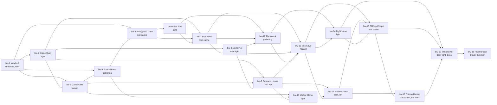
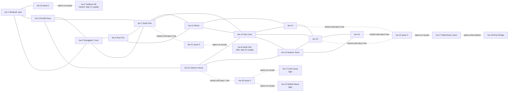

# The Breakwater (Act 1, Chapter 1): node map (draft for T's review)

> A rough map of every Breakwater node, read from the current tree on 2026-10-26: the graph in
> `axiomancer-mechanics/src/World/Continents/Coastal-Village/breakwater.ts`, the events in
> `axiomancer-mechanics/src/World/MapEvents/content.ts`, and the labels in
> `axiomancer-mobile/state/exploration-maps/breakwater.layout.ts`. It describes what ships today, not a design.
> Each region is a chapter (D106, T 2026-10-26): Act 1 is the four regions, and the Breakwater is Chapter 1, the
> Nov 16 MVP's scope.

## The shape

Eighteen nodes in seven columns. The windmill (bw-1) is the start; the map fans out in rings and closes on one
chokepoint, the watchtower (bw-17), before the river bridge (bw-18), the door out.

Arrows step to the next column; plain lines are the lateral ribs between neighbours in a ring (both ways).

## Every node

| Node | Col | Place | Kind | What happens today | Connects to |
|---|---|---|---|---|---|
| bw-1 | 0 | The Windmill | cutscene | Two arrival lines; a new game starts here | bw-2, bw-3, bw-4, bw-5 |
| bw-2 | 1 | The Crane Quay | encounter | Float-Eye, level 2 | bw-7, bw-8, bw-9, bw-3 |
| bw-3 | 1 | Gallows Hill | hazard | 2 damage (placeholder until hazard routing; a puzzle board in the plan) | bw-9, bw-10, bw-2, bw-4 |
| bw-4 | 1 | The Foothill Pass | gathering | 1 Driftwood | bw-10, bw-3, bw-5 |
| bw-5 | 1 | Smugglers' Cove | loot cache | 12 shillings | bw-6, bw-7, bw-4 |
| bw-6 | 2 | The Sea Fort | encounter | Float-Eye, level 2, with its own line | bw-11, bw-7 |
| bw-7 | 2 | The South Pier | loot cache | 6 shillings | bw-11, bw-12, bw-6, bw-8 |
| bw-8 | 2 | The North Pier | encounter (elite) | Green Jelly, level 3 | bw-12, bw-11, bw-7, bw-9 |
| bw-9 | 2 | The Customs House | rest (inn) | Paid rest | bw-13, bw-12, bw-8, bw-10 |
| bw-10 | 2 | The Walled Manor | encounter | Float-Eye, level 2 | bw-13, bw-9 |
| bw-11 | 3 | The Wreck | gathering | 1 Kelp Frond | bw-14, bw-12 |
| bw-12 | 3 | The Sea Cave | hazard | 2 damage (placeholder, as bw-3) | bw-14, bw-15, bw-11, bw-13 |
| bw-13 | 3 | The Harbour Town | rest (inn) | Paid rest | bw-15, bw-16, bw-12 |
| bw-14 | 4 | The Lighthouse | encounter | Float-Eye, level 2 | bw-17, bw-15 |
| bw-15 | 4 | The Clifftop Chapel | loot cache | 8 shillings | bw-17, bw-14, bw-16 |
| bw-16 | 4 | The Fishing Hamlet | blacksmith | The Anvil (one per region) | bw-17, bw-15 |
| bw-17 | 5 | The Watchtower | encounter (boss) | Death Beholder, level 1, the door fight every run crosses | bw-18 |
| bw-18 | 6 | The River Bridge | travel | Crosses to the Charcoal Wood | none (terminal) |

Kind spread: 6 encounters (4 normal, 1 elite, 1 boss), 2 hazards, 2 gathering, 3 loot caches, 2 rests, 1 blacksmith,
1 cutscene, 1 travel.

## Gaps

Every node has an event (the pool builder throws on a node without one), so no node is empty. The gaps are in what
the events hold:

- **Enemies:** three foes only, all R2 survivors: Float-Eye on every normal node, the Green Jelly as the elite, the
  Death Beholder at the door. B2 (the enemy revamp) is where the real roster comes from.
- **Boss tiers:** the watchtower holds the region's door fight, and it is Chapter 1's boss, B2's "region boss" tier
  (T, 2026-10-26; D106). Act 1's Act Boss sits at the end of the Lantern Deep, Chapter 4, not here (T, 2026-10-26).
- **Hazards:** bw-3 and bw-12 deal a flat 2 damage. They become puzzle boards when the live hazard routing is
  plotted (`plan/deadlines.md`, W2).
- **No people:** Act 1 stages no NPC, shop, village or narration node (`MapEvents/content.ts` header), so the
  `interaction`, `village` and `narration` kinds have no Breakwater node.
- **No quests:** none exist yet. QL1 (T, 2026-10-27, D111; LR1f skipped; routing answered by T 2026-10-28) adds one
  four-step questline on four new `quest` nodes, bw-19..bw-22, the Breakwater's ninth kind, and re-points the graph
  so each step's foes and hazards sit in a pocket behind that step's own node (see "Planned: the questline's
  routing" below). Steps 1-3 are turned in at the next quest node and step 4 is the boss. T checks the spots in the
  Nov 3 map review and writes the lines on Nov 10.
- **Gathering has no sink:** nothing spends Driftwood or Kelp Frond (`docs/reports/act1-event-audit.md`). AW1b puts
  the question to T.
- **Loot caches:** shillings and the cache's card offer; no item or relic comes from a Breakwater node besides
  fight rewards until LR1's quests and elite drops land.
- **The door:** bw-18 travels to the Charcoal Wood, Chapter 2.

## Planned: the questline's routing (QL1, not built; T may move any of it)

T, 2026-10-28: the next quest node is locked until the current step is met, and "we can move around all the nodes
whenever we need to". The plan keeps every kind, foe and level, and re-points edges so that a step's supply cannot
be used before the step is accepted: it lives in a pocket reachable only through that step's marker. A quest node
(and the watchtower) opens its roads only once spent, so a fled or lost fight at the watchtower leaves the bridge
shut with no sealed road. Edges are undirected; spots are picked by plate neighbours and are T's to move on Nov 3.

| Step | Marker | Locked until | Supply (opens when the marker is spent) |
|---|---|---|---|
| 1 | bw-19, off the windmill | (the chapter start) | bw-3, the Gallows Hill hazard (1) |
| 2 | bw-20, off the customs house | step 1 is met | bw-2 and bw-10, two normal fights (2) |
| 3 | bw-21, off the south pier | step 2 is met | bw-8, the North Pier elite (1) |
| 4 | bw-22, between the chapel and the watchtower | step 3 is met | bw-17, the boss (1), then bw-18 |

Each pocket holds exactly as many nodes as the placeholder goal, so a goal T raises on Nov 10 needs a node moved into
its pocket (the supply test fails loudly otherwise). The sea cave (bw-12) is a second hazard in the open fan, and
counts toward step 1 once accepted but not as supply the test relies on.
